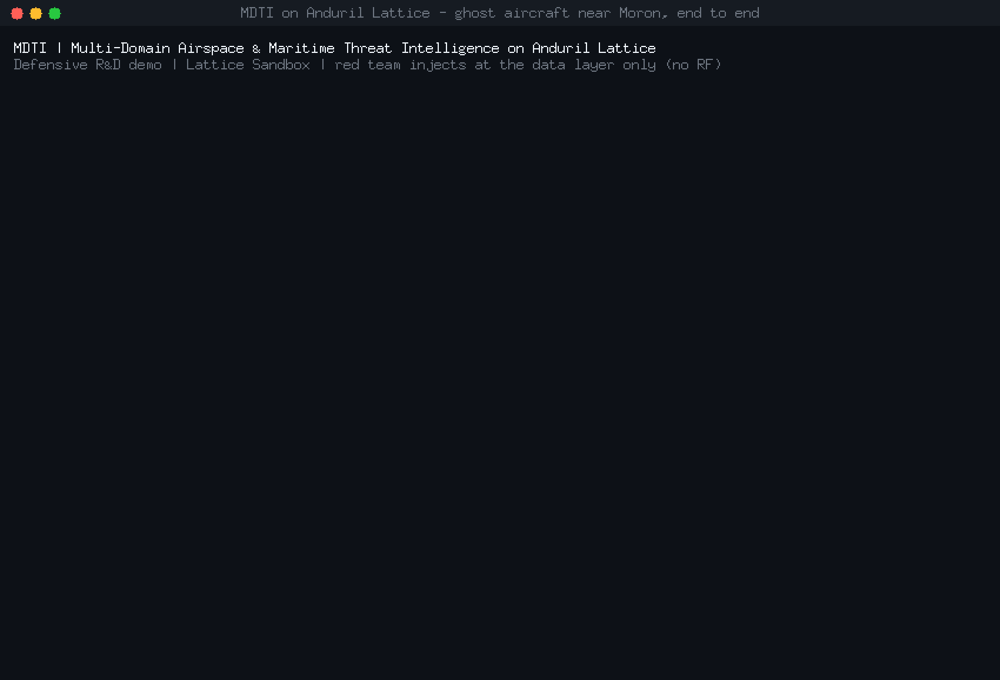
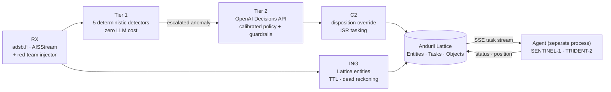

# MDTI — Multi-Domain Airspace & Maritime Threat Intelligence on Anduril Lattice

[](https://github.com/b45t3rr/lattice-mdti/actions/workflows/ci.yml)
[](https://github.com/b45t3rr/lattice-mdti/actions/workflows/codeql.yml)
[](go.mod)
[](LICENSE)

Open-source R&D pipeline that detects spoofing and evasion in the unauthenticated surveillance
protocols **ADS-B** and **AIS**, and responds through **Anduril Lattice**: it reclassifies the
offending track and dispatches an autonomous ISR asset to identify it.

It runs over live traffic for the Buenos Aires metropolitan area (Morón SADM, Ezeiza SAEZ,
Aeroparque SABE) and the Argentine Exclusive Economic Zone ("mile 200" in the South Atlantic).



<sub>Recorded live against a Lattice Sandbox with `make demo`. Every step is real: live ADS-B and AIS
traffic, the OpenAI Decisions API, Lattice entity overrides, the Tasks API and a separate agent process.
Only the ghost aircraft is synthetic, injected at the data layer.</sub>

## How it works



| Module | What it does |
|---|---|
| **RX** | Live ADS-B (adsb.fi, about 1 Hz) and AIS (AISStream WebSocket). A deterministic red-team injector covers kinematic teleport and overspeed, baro/GNSS divergence (GPS spoofing), a ghost aircraft near Morón, and a dark vessel at mile 200. It can hijack real tracks. Record and replay. |
| **ING** | Publishes complete `TEMPLATE_TRACK` entities (MIL-STD-2525C symbology, alternate ids, transponder codes, nationality from the MMSI) with expiry, and dead-reckons dark vessels so the threat stays on the map. |
| **Tier 1** | Five deterministic detectors on the stream clock: kinematic impossibility, baro/GNSS divergence, ghost track, EEZ dark vessel, navigation-integrity drop. |
| **Tier 2** | The [OpenAI Decisions API](https://developers.openai.com/api/docs/guides/decisions) answers three closed questions (probability, category, threat level). A versioned, calibrated policy turns them into a disposition and an ISR task. Attacker-controlled text never reaches the model. Every decision is stored as evidence in Lattice Objects. |
| **C2 + Agent** | Overrides `mil_view.disposition` and dispatches `VisualId` or `Investigate` tasks. A separate agent process flies SENTINEL-1 (UAV, Morón) or TRIDENT-2 (maritime patrol, Comodoro Rivadavia) through the full Lattice task lifecycle. |

The full design, data contracts, formulas and every verification result are in **[`SPEC.md`](SPEC.md)**.

## Verified results

| | Result |
|---|---|
| Tier 1, 4 attack scenarios × 20 seeds | recall **1.00**, **0** false positives |
| Tier 1, 35 min of clean live traffic (89 entities) | **0** anomalies |
| Tier 2 calibration (gpt-6-luna), fit and held-out seeds | **0** false HOSTILE on benign controls, 100 % category accuracy |
| Prompt injection broadcast as a callsign | no effect: P = 0.92, HOSTILE on 6/6 seeds |
| Live end-to-end (the GIF above) | detection 2 s → decision 2 s → task 1 s → `DONE_OK` |
| Task lifecycle, cancel, orphan recovery, single-writer lock | verified live from separate processes |

Known limitation: the maritime decision has the thinnest margin (a dark fishing vessel scores
P = 0.85–0.89 against 0.82 for the hardest benign control). See SPEC §7.8.

## Quickstart

Requirements: **Go ≥ 1.27.3** (downloaded automatically through the `toolchain` directive). For live
use you also need a Lattice Sandbox, an [AISStream](https://aisstream.io) key and an OpenAI key.

```sh
git clone https://github.com/b45t3rr/lattice-mdti && cd lattice-mdti
go test ./...                      # everything offline: no network, no credentials

# Offline: render the attacks, detect them, score against ground truth
make evaluate

# Live (fill in .env first: see .env.example)
cp .env.example .env
go run ./cmd/validate ping                         # Lattice credentials
go run ./cmd/mdti -modules=rx -dry-run             # live AMBA aircraft + EEZ vessels, nothing published
go run ./cmd/mdti                                  # full pipeline (AUTONOMY_LEVEL=supervised by default)
```

### Run the demo

```sh
make demo        # builds, runs agent + daemon as separate processes, narrates, cleans up, renders the GIF
```

The demo needs `AUTONOMY_LEVEL=autonomous` (it sets it for its own child process). To record the
Lattice map at the same time, see [`docs/demo/RECORDING.md`](docs/demo/RECORDING.md).

### Commands

| Command | Purpose |
|---|---|
| `cmd/mdti` | The daemon: `-modules=rx,ing,tier1,tier2`, `-redteam=<scenario>`, `-record` / `-replay`, `-decisions` |
| `cmd/agent` | Simulated taskable assets (always a separate process; single-writer lock) |
| `cmd/redteam` | Render attack scenarios offline into a replay file plus ground truth |
| `cmd/evaluate` | Score Tier 1 on a recording; non-zero exit below the recall gate |
| `cmd/calibrate` | Fit Tier-2 thresholds on labelled samples, validate on held-out seeds |
| `cmd/validate` | Separate-process checks: `ping`, `get`, `watch`, `object`, `task`, `create-task`, `cancel`, `clear`, `target` |
| `cmd/demo`, `tools/cast2gif` | Recorded demo and GIF rendering |

## Repository layout

```
cmd/            executables (see above)
internal/       rx (adsb, ais, redteam, replay, bus) · ing · tier1 · tier2 · c2 · agent · evidence · geo · lattice · config · domain
data/geo/       Marine Regions EEZ polygons and 200 NM lines (unmodified, hash-pinned) + zone policy registry
data/tier2/     calibrated decision policy (thresholds + calibration record)
scenarios/      red-team attack scenarios (YAML)
testdata/       fixtures and golden files
docs/demo/      recorded demo (asciicast + GIF) and recording guide
SPEC.md         master specification and verification log
```

## Safety and scope

MDTI is **defensive** research. The red team injects only at the **data layer**: nothing transmits
RF. Autonomous responses are limited to **ISR tasks** through a hard-coded allow-list, never kinetic
or effector tasking. It targets **Lattice Sandboxes** only. Autonomy is `supervised` by default, and
in disputed or joint-regime waters escalation always requires an operator. See
[`SECURITY.md`](SECURITY.md).

## Contributing

Contributions are welcome. Read [`CONTRIBUTING.md`](CONTRIBUTING.md) (spec-first workflow and
verification requirements) and the [Code of Conduct](CODE_OF_CONDUCT.md). Report vulnerabilities
privately as described in [`SECURITY.md`](SECURITY.md). Changes are tracked in
[`CHANGELOG.md`](CHANGELOG.md).

## License and attribution

Licensed under the [Apache License 2.0](LICENSE). Third-party data (Marine Regions, adsb.fi,
adsb.lol, AISStream) and trademarks are credited in [`NOTICE`](NOTICE). "Anduril" and "Lattice" are
trademarks of Anduril Industries; this project is independent and not affiliated with or endorsed
by Anduril.
