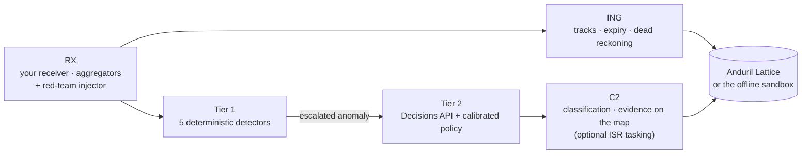

# MDTI — Multi-Domain Airspace & Maritime Threat Intelligence

[](https://github.com/b45t3rr/lattice-mdti/actions/workflows/ci.yml)
[](https://github.com/b45t3rr/lattice-mdti/actions/workflows/codeql.yml)
[](go.mod)
[](LICENSE)

Open-source detector of **spoofing and evasion** in the two unauthenticated surveillance protocols
that track aircraft (**ADS-B**) and ships (**AIS**). Connect your own receiver or a public feed,
and MDTI flags the tracks that physics, geography or the protocol itself say cannot be genuine.
Each alert shows **why**: the measured inconsistency, drawn on the map.

It ships configured for the Buenos Aires area (Morón SADM, Ezeiza SAEZ, Aeroparque SABE) and the
Argentine 200 NM line (the "Milla 201"). It integrates with **Anduril Lattice**, which classifies
tracks and draws the evidence on its common operating picture.


<sub>`make demo-offline`, no accounts needed. The four threats are synthetic and injected at the data
layer, so nothing transmits RF.</sub>

## What it detects

| Inconsistency | How it is caught | Evidence shown |
|---|---|---|
| **Impossible flight physics** | Implied speed or acceleration between consecutive reports beyond any airframe; teleports | The jump drawn on the map: "22.2 km in 3 s · 7,443 m/s (Mach 22)" |
| **GPS spoofing** | GNSS altitude drifting away from barometric altitude against its own baseline; NIC/NACp collapse | "GNSS altitude +1100 ft from baro (+725 ft off its baseline) · NACp 4" |
| **Ghost aircraft** | An airborne identity that appears mid-coverage with no history near a protected aerodrome | "First seen 8.0 NM from SADM, airborne, no track history" + first-fix marker |
| **AIS switched off at the 200 NM line** | A vessel that goes silent within 12 NM of the EEZ limit while heading in, or whose dead-reckoned position is already inside | "AIS silent 3m12s · last report 5.0 NM outside the 200 NM line · heading into the EEZ (32° off the inward normal) · turned 70° before going silent" + estimated track |
| **Navigation integrity drop** | Corroborating NIC/NACp/SIL collapse | flag on the alert |

Detection runs in two tiers.
- **Tier 1:** five deterministic, unit-tested detectors on the stream clock. It costs nothing to
  run and is reproducible.
- **Tier 2:** escalated anomalies go to the OpenAI Decisions API (three closed questions), and a
  versioned, calibrated policy turns the answers into a disposition. Attacker-controlled text
  (callsigns, ship names) never reaches the model. If the API fails, a deterministic fallback
  marks the track as suspect. Tier 2 is optional: `-modules=rx,tier1` runs detection alone, with no
  keys at all.

## Sources: public feeds or your own antenna

| `SOURCES` entry | Reads |
|---|---|
| `readsb:http://<rx>:8080` | your ADS-B receiver's `aircraft.json` (readsb, dump1090-fa, tar1090) |
| `sbs:<rx>:30003` | your ADS-B receiver's BaseStation feed |
| `nmea-udp::10110` / `nmea-tcp:<host>:<port>` | AIS NMEA `!AIVDM` from AIS-catcher, rtl-ais, dAISy… |
| `adsb` · `aisstream` | public aggregators (adsb.fi / adsb.lol, AISStream) |

No hardware? `tools/receiver-sim` pretends to be a receiver. Setup for real receivers, and how to
write a new adapter, are in **[`docs/SOURCES.md`](docs/SOURCES.md)**.

## How it works



The full design, data contracts, formulas and every verification result are in **[`SPEC.md`](SPEC.md)**.

## Quickstart

Requirements: **Go ≥ 1.27.3** (fetched automatically through the `toolchain` directive).

```sh
git clone https://github.com/b45t3rr/lattice-mdti && cd lattice-mdti
go test ./...          # offline: no network, no credentials
make demo-offline      # the whole pipeline + a live map at http://127.0.0.1:8740/
make evaluate          # render the attacks, detect them, score against ground truth
```

Without `make` (Windows, for example): `go build -o bin/ ./cmd/... ./tools/...` then
`./bin/demo -offline`.

With your own receiver (detection only, results in the log and `-anomalies` file):

```sh
go run ./cmd/mdti -env "" -modules=rx,tier1 -sources=readsb:http://192.168.1.50:8080,nmea-udp::10110 \
    -anomalies anomalies.jsonl
```

With Lattice and Tier 2 (copy `.env.example` to `.env` and fill it in):

```sh
go run ./cmd/validate ping          # Lattice credentials
go run ./cmd/mdti -tasking=false    # classify + draw evidence in Lattice, never dispatch assets
```

### The demo

`make demo-offline` runs four acts, numbered in the order they are detected: a ghost near Morón,
impossible physics, GPS spoofing over the Río de la Plata, and AIS switched off at the Milla 201.
Each act goes from injection to detection, then decision, then the map. It is detection only:
no asset is dispatched. `make demo` runs the same acts against a real Lattice Sandbox, over live
ADS-B and AIS.

The offline mode uses the same binaries and code paths, and only two URLs change
(`LATTICE_ENDPOINT` and `OPENAI_BASE_URL` both point at `cmd/sim`). Three things are simulated, and
each one is labelled as such:

- **The platform:** `cmd/sim` is an in-memory model of the Lattice REST subset MDTI uses, not Lattice.
- **Tier 2:** a stub replays the model answers recorded in the live run and reports
  `model: offline-stub (recorded answers)`.
- **Background traffic:** `SYN`-labelled aircraft and vessels, the control group Tier 1 must ignore.

The sandbox listens on loopback only. To record the real Lattice C2, see
[`docs/demo/RECORDING.md`](docs/demo/RECORDING.md).

## Anduril Lattice integration

When connected to a Lattice Sandbox, MDTI:
- publishes complete `TEMPLATE_TRACK` entities (MIL-STD-2525C symbology, alternate ids,
  transponder codes, nationality from the MMSI);
- overrides `mil_view.disposition` with provenance, so every reclassification is auditable;
- stores every decision as evidence in Lattice Objects;
- draws map layers: watch zones, 200 NM lines, alert markers, the geometry of each inconsistency,
  and dead-reckoned tracks.

ISR tasking (`VisualId` / `Investigate`) to a simulated patrol agent (`cmd/agent`) is optional and
off in the demo (`-tasking=false`).

## Verified results

| | Result |
|---|---|
| Tier 1, attack scenarios × 20 seeds | recall **1.00**, **0** false positives |
| Tier 1, 35 min of clean live traffic (89 entities) | **0** anomalies |
| Tier 1, 30 min of synthetic background traffic | **0** anomalies (automated test) |
| Tier 2 calibration (gpt-6-luna), fit and held-out seeds | **0** false HOSTILE on benign controls, 100 % category accuracy |
| Prompt injection broadcast as a callsign | no effect: P = 0.92, HOSTILE on 6/6 seeds |
| Live 4-act demo on a Lattice Sandbox | detection 2 s, decision 1–2 s, evidence on the map 1 s after the decision |

Known limitation: the maritime decision has the thinnest margin (a dark fishing vessel scores
P = 0.85–0.89 against 0.82 for the hardest benign control). See SPEC §7.8.

## Commands

| Command | Purpose |
|---|---|
| `cmd/mdti` | The daemon: `-sources`, `-modules=rx,ing,tier1,tier2`, `-tasking`, `-redteam`, `-record` / `-replay`, `-anomalies`, `-decisions` |
| `cmd/demo` | The 4-act demo (`-offline` for the sandbox, `-cast` to record) |
| `cmd/sim` | Offline sandbox: simulated Lattice subset, Decisions stub, live map |
| `cmd/redteam`, `cmd/evaluate` | Render attack scenarios into a replay file + ground truth; score Tier 1 against it |
| `cmd/calibrate` | Fit Tier-2 thresholds on labelled samples, validate on held-out seeds |
| `cmd/validate` | Separate-process checks against Lattice: `ping`, `get`, `watch`, `object`, `task`, probes |
| `cmd/agent` | Optional simulated ISR assets for tasking (separate process, single-writer lock) |
| `tools/receiver-sim` | A fake local receiver (SBS, aircraft.json, AIS NMEA) for trying sources without hardware |
| `tools/cast2gif` | Renders the demo recording to the GIF above |

## Repository layout

```
cmd/            executables (see above)
internal/       rx (adsb, ais, sbs, sources, redteam, replay, synth, bus) · tier1 · tier2 · c2 · ing
                · viz · sim · evidence · agent · geo · lattice · config · domain
data/geo/       Marine Regions EEZ polygons and 200 NM lines (unmodified, hash-pinned) + zone policy
data/tier2/     calibrated decision policy (thresholds + calibration record)
scenarios/      red-team attack scenarios (YAML)
docs/           SOURCES.md (receivers and adapters), demo recording
SPEC.md         master specification and verification log
```

## Roadmap

- Alert outputs that need no Lattice: JSONL and a generic webhook (Slack, Discord, ntfy).
- Emergency squawks (7500 / 7600 / 7700) as alerts.
- Behavioural detectors: loitering, vessel rendezvous and transshipment, AIS identity reuse.

Ideas and pull requests are welcome; see below.

## Safety and scope

MDTI is **defensive** research. The red team injects only at the **data layer**: nothing transmits
RF. Responses are limited to classification, evidence and, optionally, **ISR tasks** through a
hard-coded allow-list, never kinetic or effector tasking. The Lattice integration targets
**Sandboxes**. Autonomy is `supervised` by default, and in disputed or joint-regime waters
escalation always requires an operator. See [`SECURITY.md`](SECURITY.md).

## Contributing

Contributions are welcome, especially new source adapters ([`docs/SOURCES.md`](docs/SOURCES.md))
and detectors. Read [`CONTRIBUTING.md`](CONTRIBUTING.md) (spec-first workflow and verification
requirements) and the [Code of Conduct](CODE_OF_CONDUCT.md). Report vulnerabilities privately as
described in [`SECURITY.md`](SECURITY.md). Changes are tracked in [`CHANGELOG.md`](CHANGELOG.md).

## License and attribution

Licensed under the [Apache License 2.0](LICENSE). Third-party data (Marine Regions, adsb.fi,
adsb.lol, AISStream), libraries and trademarks are credited in [`NOTICE`](NOTICE). "Anduril" and
"Lattice" are trademarks of Anduril Industries; this project is independent and not affiliated
with or endorsed by Anduril.
